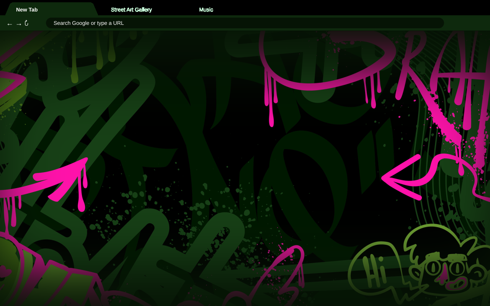
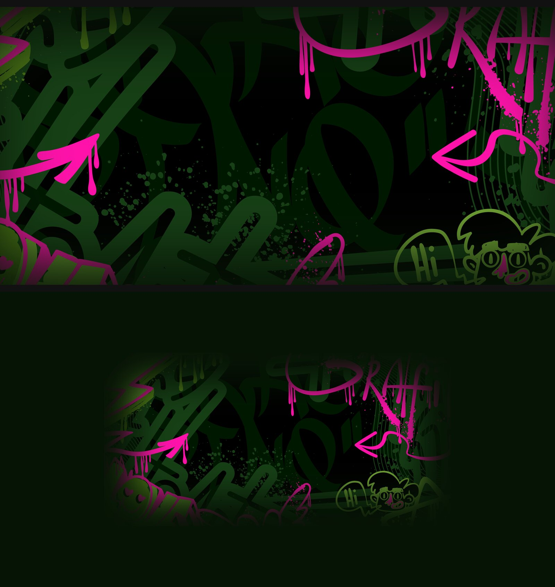

# Graffiti Neon Street

A dark-mode Chrome / Chromium theme: a neon green and hot-pink street-art wall on
the New Tab page, with deep-green tabs, toolbar and window frame.



## Features

- **AAA contrast.** All tab, toolbar and address-bar text meets WCAG AAA (7:1),
  and the build fails if any check drops below that.

  | Text | Background | Ratio |
  |---|---|---|
  | Active tab, toolbar icons, bookmarks | `#0E290D` toolbar | 15.65:1 |
  | Inactive tabs | `#0B1F0A` textured frame (worst-case pixel) | 12.24:1 |
  | Address bar | `#061405` omnibox | 18.92:1 |

- **Fits small and large screens.** Chrome never scales a theme's New Tab image,
  so the 2400×1200 artwork is centred and its edges fade into a matching solid
  colour (`#061405`). It fills a laptop screen, and on a large monitor (4K or a
  43" display) it blends into the surrounding colour with no visible edge.



## Install

- **Chrome Web Store:** coming soon.
- **Manual install:**
  1. Clone this repo.
  2. Open `chrome://extensions` and turn on **Developer mode**.
  3. Click **Load unpacked** and choose the `theme/` folder.

## Build

Requires Python 3, ImageMagick 7 (`magick`), `rsvg-convert` (librsvg) and `zip`.

```bash
python3 build.py                   # theme/, store/ assets, dist/graffiti-neon-street-<version>.zip
python3 build.py --image art.jpg   # use different artwork
python3 build.py --random [SEED]   # use a randomly generated graffiti wall instead
```

`build.py` writes:

| Output | Contents |
|---|---|
| `theme/` | the unpacked theme |
| `store/` | Web Store icon, screenshot and promo tiles |
| `dist/` | the upload zip |

To release a new version, bump `VERSION` in `build.py`, then rebuild.

## Credits

The background artwork (`source/wall.jpg`) is a royalty-free street-art
illustration. The theme code and build script are MIT licensed (see `LICENSE`).
